# Project 1 — The Five Classes of Learners

## 1. Identification

**Student:** João Vitor Ferreira
**NMEC:** 106078 
**Course:** Fundamentos de Aprendizagem Automática (FAA) 
**Project:** Project 1 — The Five Classes of Learners  
**Dataset and task:** German Credit : binary classification of credit risk (`good` or `bad`).
**Date:** 09/11/2026
**Repo:** https://github.com/jvbdf/faa-project01-jvbdf

## 2. Models

This project compares five machine learning algorithms, one from each of the five classes of learners described by Pedro Domingos in *The Master Algorithm* (2015). Each class follows a different approach to learning from data: including decision rules, adjusting neural network weights, searching through candidate solutions, estimating probabilities, or comparing similar observations.

The German Credit dataset provides a common classification task for these approaches. It contains 1,000 observations with both categorical and numerical features. Table 1 summarises the selected learners and the reasons for their selection. The preprocessing steps and evaluation procedure are described in Section 4, while the experimental results are discussed in Section 5.

| Class | Learner | Main idea and reason for selection |
|---|---|---|
| Symbolists | Decision Tree | Learns decision rules from feature splits. It can represent non-linear relationships and its decisions are relatively easy to inspect. |
| Connectionists | Multi-Layer Perceptron (MLP) | Adjusts network weights through backpropagation. A small neural network can learn non-linear combinations of the input features. |
| Evolutionaries | Linear classifier trained with Differential Evolution | Evolves the classifier's weights and bias to minimise classification cost directly. Evolution is the learning method, not only a hyperparameter search technique. |
| Bayesians | Categorical Naive Bayes (CategoricalNB) | Estimates class probabilities from discrete feature values. It is suitable for a dataset with many categorical attributes. |
| Analogizers | K-Nearest Neighbors (KNN) | Classifies new observations using similar training examples. It provides a direct way to examine the role of similarity in credit risk prediction. |

*Table 1: Selected learners, their learning approaches and the reasons for their selection.*

### 2.1. Symbolists — Decision Tree

A Decision Tree learns rules by repeatedly splitting the training data according to feature values. Each path from the root to a leaf represents a sequence of conditions leading to a prediction. This makes the model relatively easy to interpret and places it in the Symbolist class.

A tree was selected because credit risk may depend on combinations of attributes rather than on a single linear relationship. Its ability to make successive splits is useful for studying these combinations. At the same time, trees can become too specific to the training data if their complexity is not controlled.

The implementation uses `DecisionTreeClassifier` with the Gini criterion and `class_weight=None`. Two hyperparameters were tuned to control tree complexity:

| `max_depth` | `min_samples_leaf` |
|---:|---:|
| 3 | 15 |
| 5 | 15 |
| 5 | 5 |
| 8 | 5 |

*Table 2: Hyperparameter configurations evaluated for the Decision Tree.*

`max_depth` limits the maximum depth of the tree, while `min_samples_leaf` sets the minimum number of observations in a leaf. Categorical variables are one-hot encoded, and numerical variables are kept in their original scale. Feature scaling is not required for the tree's splitting criterion. The random seed is `106078`.

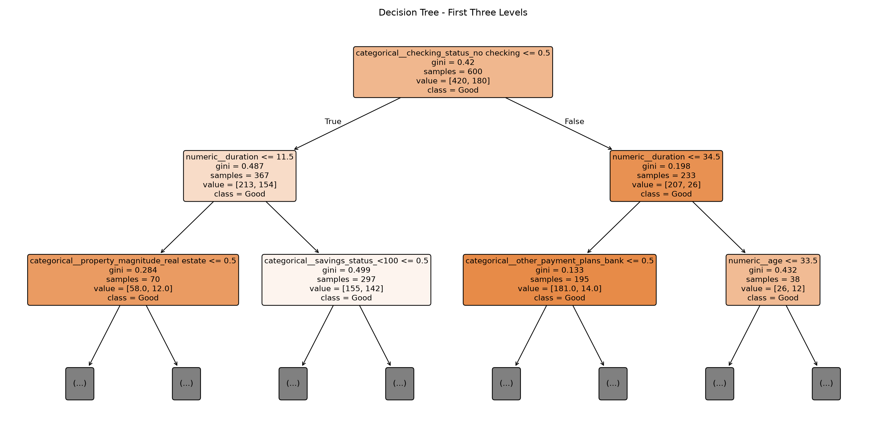

*Figure 1: First three levels of a Decision Tree fitted on an inner training partition. The nodes show the conditions used to split the observations.*


### 2.2. Connectionists — Multi-Layer Perceptron

The Multi-Layer Perceptron (MLP) learns by updating the weights between neurons through backpropagation. Its hidden neurons use non-linear activation functions, allowing the model to represent relationships that cannot be described by a single linear decision boundary.

A small network was selected because the German Credit dataset contains only 1,000 observations. The implementation uses one hidden layer, with either 8 or 16 neurons. The regularisation parameter `alpha` was also varied to control the size of the learned weights.

| `hidden_layer_sizes` | `alpha` |
|---|---:|
| `(8,)` | 0.001 |
| `(8,)` | 0.1 |
| `(16,)` | 0.001 |
| `(16,)` | 0.1 |

*Table 3: Hyperparameter configurations evaluated for the MLP.*

The model uses ReLU activation, the Adam optimiser, a fixed initial learning rate of `0.001` and `max_iter=800`. The setting `early_stopping=False` avoids using a separate stopping decision based on the model's default validation score. Hyperparameter selection is instead handled by the project's inner cross-validation and classification cost.

The numerical features are standardised and the categorical features are one-hot encoded. The random seed is `106078`.

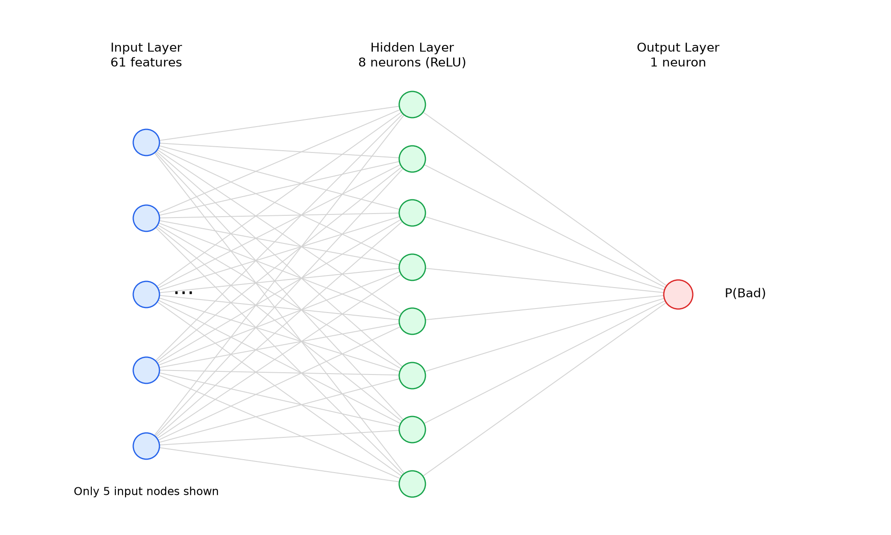

*Figure 2: Simplified architecture of the MLP with 61 input features, one hidden layer with 8 neurons and one output neuron. Only a subset of the input connections is shown.*


### 2.3. Evolutionaries — Differential Evolution

Evolutionary algorithms are based on the idea of improving a population of candidate solutions over several generations. Instead of learning through gradients or explicit rules, these algorithms generate new solutions, evaluate their quality and keep those that perform better.

For this class, Differential Evolution (DE) was selected, using the `pyBlindOpt` library. So as mentioned in the requirement of the project, the evolutionary algorithm must be responsible for learning the model itself, rather than only selecting hyperparameters for another classifier.

Some approaches were considered, such as evolving decision rules, selecting features or optimising the weights of a model. The chosen approach was to use Differential Evolution to learn the weights and bias of a linear classifier directly.

This decision was mainly related to the size and characteristics of the German Credit dataset. Although it contains only 1,000 observations, its categorical features increase the number of inputs after one-hot encoding. In the implemented preprocessing, the original 20 features become 61, meaning that each candidate solution contains 62 parameters, including the bias. Evolving a more complex model, such as a neural network, would considerably increase the number of parameters and the computational cost.

The classifier calculates a score for each observation:

$$
s(x) = w^T x + b
$$

If the score is greater than or equal to zero, the observation is classified as `bad` (1). Otherwise, it is classified as `good` (0).

Differential Evolution starts with a population of candidate weight vectors. During each generation, new candidates are created through mutation and crossover. Their fitness is evaluated, and better solutions are retained for the following generations.

The implementation uses the `rand/1/bin` variant and directly minimises the mean classification cost:

$$
\operatorname{Cost} = \frac{FP + 5FN}{N}
$$

This fitness function was chosen because it follows the cost structure of the German Credit problem. False negatives, which correspond to bad credit risks incorrectly classified as good, have a cost five times higher than false positives.

Two configurations were evaluated:

| `n_pop` | `n_iter` |
|---:|---:|
| 30 | 30 |
| 40 | 22 |

*Table 4: Hyperparameter configurations evaluated for Differential Evolution.*

The configurations use similar computational budgets, but distribute the search effort differently between population size and number of generations. The remaining settings were fixed: mutation factor `F=0.7`, crossover rate `cr=0.9`, `policy="fixed"`, parameter bounds of `[-2, 2]` and random seed `106078`.

The preprocessing consists of one-hot encoding for categorical features and standardisation for numerical features, so that all inputs can be represented numerically and differences in scale are reduced.

One limitation of this approach is that the final classifier still uses a linear decision boundary, which may not capture more complex relationships between credit attributes. Another difficulty comes from the fitness function itself. Since the predictions are binary, small changes in the weights do not always change the classification cost. This creates regions where different candidate solutions receive the same fitness value, making the evolutionary search more difficult.

Despite these limitations, this approach provides a direct implementation of evolutionary learning, since the weights used for classification are obtained through Differential Evolution rather than through a conventional training algorithm.

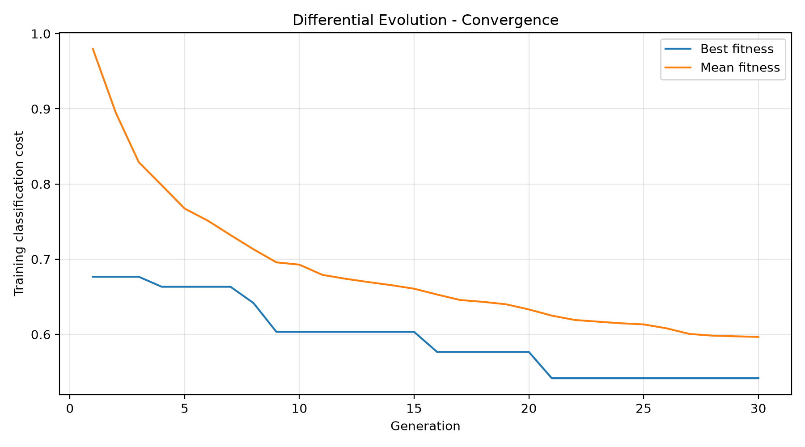

*Figure 3: Best and mean fitness during 30 generations of Differential Evolution. The fitness corresponds to the classification cost on an inner training partition.*


### 2.4. Bayesians — Categorical Naive Bayes

Categorical Naive Bayes estimates class probabilities using Bayes' theorem and the observed values of the input features. It assumes that the features are conditionally independent given the class. This simplifies learning, although some credit attributes may be related in practice.

`CategoricalNB` was selected because 13 of the 20 input features are categorical. The remaining numerical features require a discrete representation.

In the implementation, `duration`, `credit_amount` and `age` are divided into quantile-based bins. The other four numerical features have few possible values and are passed through as discrete inputs. Categorical attributes are encoded as non-negative integer categories.

| `alpha` | `n_bins` |
|---:|---:|
| 0.5 | 3 |
| 2.0 | 3 |
| 0.5 | 5 |
| 2.0 | 5 |

*Table 5: Hyperparameter configurations evaluated for CategoricalNB.*

`alpha` controls additive smoothing, which reduces the effect of categories that are rare or absent in a training partition. `n_bins` determines the number of intervals used for the three discretised numerical features.

The conditional-independence assumption makes the model computationally efficient, but it can also affect the reliability of its probability estimates.

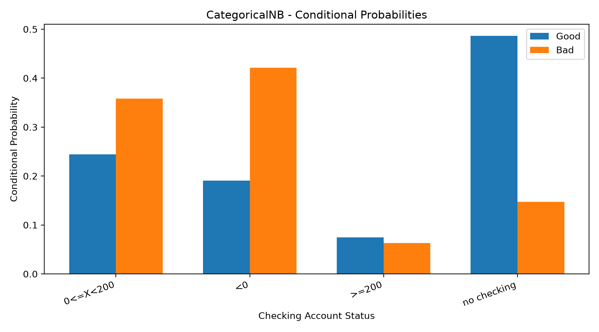

*Figure 4: Conditional probabilities learned by CategoricalNB for the `checking_status` feature, separated by credit risk class.*


Figure 4 shows how the distribution of `checking_status` differs
between the two credit risk classes. The `no checking` category
is more common among good credit risks, while negative and low
checking account balances are more frequent among bad credit risks.

These probabilities are learned separately for each class and
are combined with the other features when making predictions.

### 2.5. Analogizers — K-Nearest Neighbors

K-Nearest Neighbors (KNN) predicts the class of a new observation using nearby examples from the training data. It belongs to the Analogizer class because its predictions depend on similarities between observations rather than on explicit rules or fitted model coefficients.

KNN was selected to examine whether clients with similar recorded characteristics tend to have similar credit outcomes. Its predictions depend on the number of neighbours considered, the distance measure and the contribution assigned to each neighbour.

| Hyperparameter | Values |
|---|---|
| `n_neighbors` | 7, 21 |
| `weights` | `uniform`, `distance` |
| `p` | 1, 2 |

*Table 6: Hyperparameter search space for KNN. All eight combinations were evaluated.*

With `weights="uniform"`, every selected neighbour has the same influence. With `weights="distance"`, closer neighbours have greater influence. The Minkowski distance uses `p=1` for Manhattan distance and `p=2` for Euclidean distance.

Categorical features are one-hot encoded and numerical features are standardised before distances are computed. This reduces the risk of large-scale numerical variables, such as `credit_amount`, dominating the distance calculation.

KNN can capture local patterns, but those patterns depend on the feature representation and distance metric.

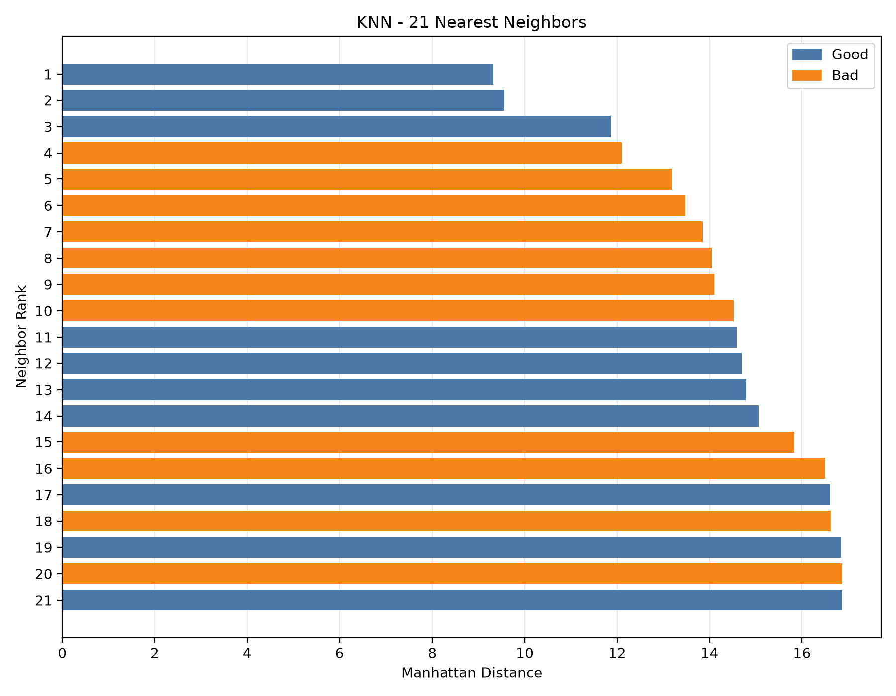

*Figure 5: Manhattan distances to the 21 nearest training observations for a selected validation example. The colours indicate the real classes of the neighbours.*

The figure illustrates how KNN uses similar observations to
classify a new client. Distances were calculated using the
Manhattan metric after preprocessing. Since distance weighting
was used, closer neighbors have a greater influence on the
predicted class than more distant ones.

### 2.6. Expected Behaviour of the Learners

The five learners were selected because they use different approaches to learning from data. Based on their characteristics and the exploratory analysis of the German Credit dataset, some differences in their behaviour could be expected.

Table 7 summarises these expectations and how they can be examined using the experimental results.

| Learner | Expected behaviour |
|---|---|
| Decision Tree | Increasing tree depth should improve training performance, but deeper trees may overfit and perform worse on validation data. |
| MLP | A small network with stronger regularisation may be more suitable for a dataset containing only 1,000 observations. |
| Evolutionary | Directly optimising classification cost may help the linear classifier outperform the constant baselines, although the limited search budget and linear representation could restrict its performance. |
| CategoricalNB | The large proportion of categorical features may favour this approach, allowing it to achieve a lower cost than the constant baselines despite its independence assumption. |
| KNN | Similarity between applicants may provide useful information for classification, although performance may vary depending on the training observations and the distance measure. |

*Table 7: Expected behaviour of the five learners based on their learning mechanisms and the characteristics of the German Credit dataset.*

These expectations are examined in Section 5 using the classification results, selected hyperparameters, variation across folds and diagnostic plots. They provide a way to discuss the strengths and limitations of each learning approach rather than comparing the final scores alone.

## 3. Dataset

### 3.1. Dataset Description

The dataset selected was the **German Credit dataset**, it contains information about credit applicants and if they were classified as good or bad credit risks.

The dataset is stored in `datasets/german_credit.csv.zst` and contains 1,000 observations, 20 input features and one target column named `class`. The original target values are `good` and `bad`, which were converted to 0 and 1, respectively, for the classification task.

The dataset is based on Hofmann, H. (1994), *Statlog (German Credit Data)*, UCI Machine Learning Repository. https://doi.org/10.24432/C5NC77

The input features describe different characteristics of the applicants and their credit history, including account status, loan duration, credit amount, employment, age and housing.

The attributes are divided into two main types:

| Feature type | Number | Description |
|---|---:|---|
| Categorical | 13 | Attributes such as `checking_status`, `credit_history`, `purpose`, `employment` and `housing`. |
| Numerical | 7 | Attributes such as `duration`, `credit_amount`, `age`, `existing_credits` and `num_dependents`. |

*Table 8: Overview of the input features in the German Credit dataset.*

Although seven features are represented numerically, they do not all have the same characteristics. `duration`, `credit_amount` and `age` cover relatively wide ranges, while `installment_commitment`, `residence_since`, `existing_credits` and `num_dependents` take only a few discrete values.

The dataset was chosen mainly because it combines categorical and numerical information, requiring different preprocessing approaches for the five learners. Its small size also makes it possible to compare the algorithms using cross-validation without requiring extensive computational resources.

Another relevant characteristic is the asymmetric cost of classification errors. Classifying a bad credit risk as good has a cost of 5, while classifying a good credit risk as bad has a cost of 1. As a result, a model with higher accuracy is not necessarily the one with the lowest classification cost.

Before training the models, the dataset was checked for missing values and duplicate observations. No missing values or fully duplicated rows were found, so missing-value imputation and duplicate removal were not necessary.

### 3.2. Target Distribution

The target contains 700 observations classified as `good` (70%) and 300 classified as `bad` (30%), as shown in Figure 6.

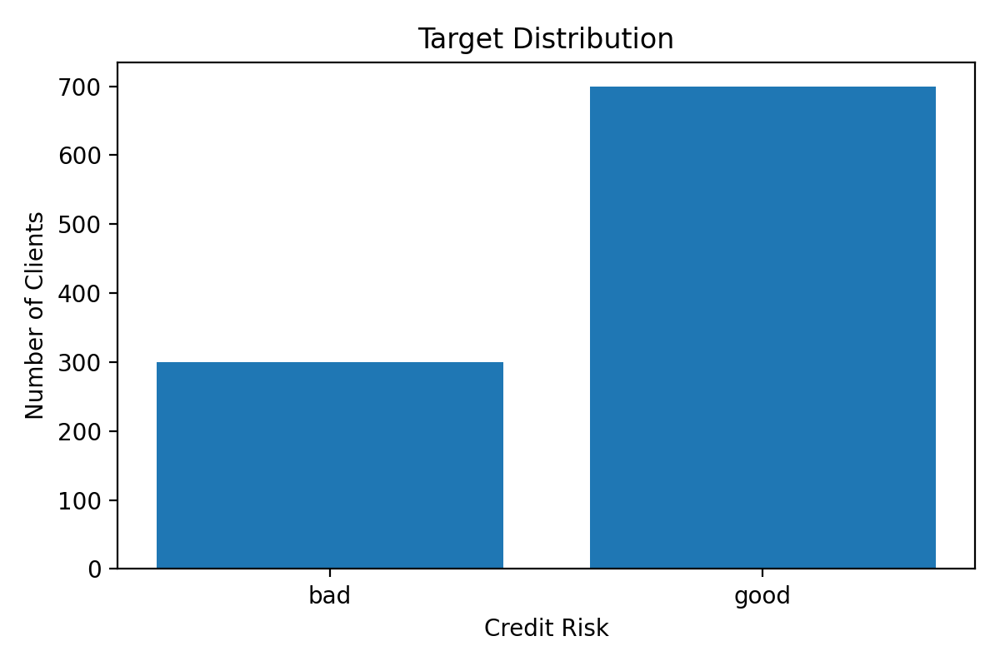

*Figure 6: Distribution of good and bad credit risks in the German Credit dataset.*

The dataset is moderately imbalanced, with more than twice as many good credit risks as bad ones.

This distribution affects how classification performance should be interpreted. For example, a model that always predicts `good` would achieve 70% accuracy without identifying a single bad credit risk. Considering the higher cost of false negatives, this would not be a useful solution for the problem.

For this reason, stratified cross-validation was selected to preserve approximately the same class proportions across the training and validation partitions. Mean classification cost was also chosen as the main evaluation metric instead of accuracy.

### 3.3. Numerical Feature Distributions

Figure 7 shows the distributions of the seven numerical attributes.

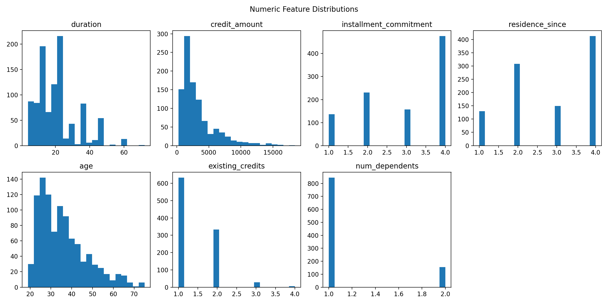

*Figure 7: Distributions of the numerical features, showing differences in scale, skewness and the number of possible values.*

The numerical features have considerably different scales. For example, `credit_amount` ranges from 250 to 18,424, while `num_dependents` only takes the values 1 and 2. Credit duration ranges from 4 to 72 months, and applicant age ranges from 19 to 75 years.

The histograms also show that some variables, particularly `duration`, `credit_amount` and `age`, are right-skewed. Most observations are concentrated in the lower ranges, with a smaller number of much higher values.

These characteristics matter for algorithms that depend on distances or the optimisation of numerical weights. Without scaling, a feature such as `credit_amount` could have a much greater influence than features with smaller numerical ranges.

Some observations also appear as outliers in the distributions. These values were kept in the dataset, since there was no evidence that they represented incorrect records.

The relationship between numerical features and the target was also examined. Figure 8 compares the distributions of `duration`, `credit_amount` and `age` for both credit risk classes.

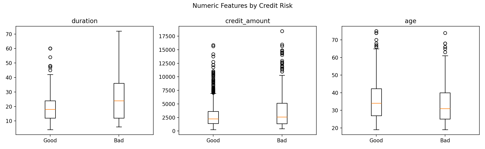

*Figure 8: Distributions of credit duration, credit amount and applicant age for the Good and Bad classes.*

The differences are particularly visible in `duration`. Bad credit risks have a median duration of 24 months, compared with 18 months for good credit risks.

Credit amounts also tend to be somewhat higher among bad credit risks, with median values of approximately 2,575 and 2,244 for the bad and good classes, respectively.

For `age`, the relationship is less pronounced. Good credit risks have a slightly higher median age of 34 years, compared with 31 years for bad credit risks.

Despite these differences, the distributions overlap considerably. None of these variables can clearly separate good and bad credit risks on its own. This suggests that some attributes may need to be considered together when making predictions.

### 3.4. Categorical Features and Credit Risk

Since most of the dataset's features are categorical, their relationship with the target is also relevant.

Two attributes were selected for a closer analysis: `checking_status` and `credit_history`. These variables describe the applicant's checking account situation and previous credit history, respectively.

Unlike the numerical attributes, categorical features cannot be compared through their original numerical scales. Instead, the proportion of bad credit risks within each category was examined.

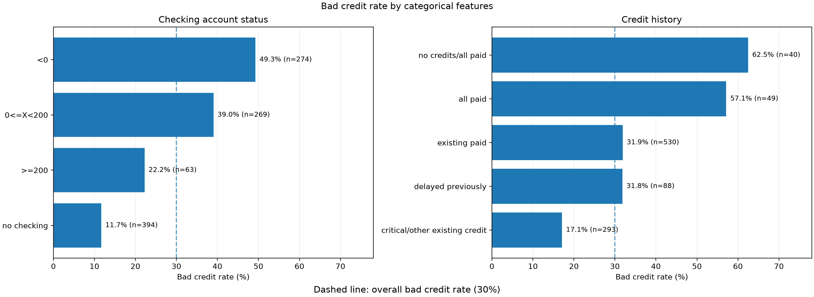

*Figure 9: Percentage of bad credit risks for each category of
`checking_status` and `credit_history`. The labels also show
the number of observations in each category. The dashed line
represents the overall bad credit rate of 30%.*


Figure 9 shows that the proportion of bad credit risks varies considerably across categorical values. For `checking_status`, approximately 49% of applicants with a negative checking account balance belong to the `bad` class. This proportion decreases to 39% for balances between 0 and 200, 22% for balances of at least 200, and 12% for applicants in the `no checking` category.

These differences suggest that checking account status is associated with credit risk. This is also consistent with the Decision Tree in Section 2, where `checking_status` appears in the first split.

Differences can also be observed in `credit_history`. The `no credits/all paid` and `all paid` categories have bad credit rates above 50%, although both contain fewer than 50 observations. These results should be interpreted carefully, since categories with fewer observations are more sensitive to individual cases.

The observed relationships describe associations within the dataset and do not necessarily imply causation.

### 3.5. Correlation Analysis

A correlation analysis was performed to examine linear relationships between the numerical features and their association with the target.

Pearson correlation was calculated using the seven numerical input features and the binary target encoded as 0 (`good`) and 1 (`bad`).

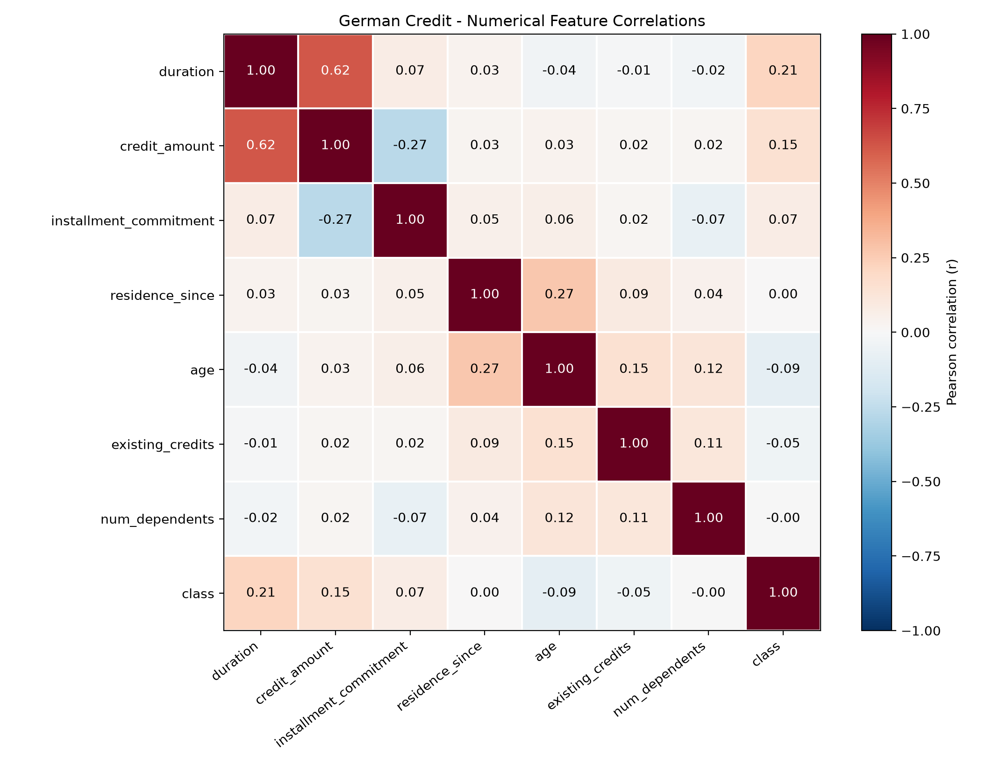

*Figure 10: Pearson correlation matrix for the seven numerical
features and the binary target (`0 = Good`, `1 = Bad`).*

Figure 10 shows that the strongest correlation between numerical
features is between `duration` and `credit_amount` (r = 0.625).
This suggests that larger credit amounts tend to be associated
with longer repayment periods.

A weaker negative correlation is also observed between
`credit_amount` and `installment_commitment` (r = -0.271),
while `age` and `residence_since` have a positive correlation
of approximately 0.266.

Regarding the target, `duration` has the highest positive
correlation (r = 0.215), followed by `credit_amount` (r = 0.155).
The correlation between `age` and the target is negative but
relatively small (r = -0.091).

Overall, the numerical features show limited individual linear
relationships with credit risk. However, this does not mean
that they are not useful for classification. Their importance
may depend on non-linear relationships, combinations of
attributes and the information provided by categorical features.

Only numerical features were included in this analysis, since
assigning arbitrary numerical codes to categorical values
could produce misleading correlations. No features were
removed based on these results.

### 3.6. Main Findings and Dataset Limitations

The exploratory analysis identified characteristics that influenced the experimental methodology.

First, the combination of categorical and numerical features requires different preprocessing strategies. Categorical attributes were encoded according to the needs of each learner, while numerical scaling was applied to the MLP, KNN and Evolutionary classifiers. For CategoricalNB, selected numerical attributes were discretised into intervals.

Second, the different numerical scales and the presence of skewed distributions were considered when defining the preprocessing pipelines. The transformations were fitted only on training data within each cross-validation fold, as described in Section 4.

Third, the target imbalance and the asymmetric classification costs make accuracy insufficient as the main performance measure. Stratified folds and a cost-sensitive evaluation metric were therefore used.

The dataset also has some limitations. With only 1,000 observations, the results may be sensitive to how the data are divided. Each outer test fold contains approximately 200 observations, including 60 bad credit risks, so a relatively small number of classification errors can affect the measured cost.

Some categorical values are also represented by relatively few observations, which may affect the reliability of their estimated distributions.

Finally, the dataset represents a fixed credit classification problem. The experiments evaluate how the five learners perform on this dataset, but do not establish whether the same results would hold for other populations or more recent credit applications.


## 4. Methodology

The five learners were evaluated using the same dataset, the same data partitions and the same classification metrics. The main objective was to compare their ability to minimise credit classification costs while keeping the evaluation independent from model training and hyperparameter selection.

Since the German Credit dataset contains only 1,000 observations, a single train-test split could produce results that depend strongly on which observations were selected for testing. For this reason, Nested Stratified Cross-Validation was used.

The methodology also includes learner-specific preprocessing, cost-sensitive threshold selection, two simple baselines and measurements of computational cost.

### 4.1. Experimental Setup

The experiment was implemented in Python using Polars for data loading, NumPy for numerical operations, scikit-learn for preprocessing and classification, and pyBlindOpt for Differential Evolution.

The random seed was fixed at `106078`. The dataset and target were loaded once, with the target converted to `0` for `good` and `1` for `bad`.

All five learners used the same outer cross-validation splits. This was important because the models were evaluated on the same observations, allowing their results to be compared under similar conditions.

The experiment followed the steps below:

1. Load the German Credit dataset and prepare the target.
2. Create five stratified outer folds.
3. For each outer fold, use its training partition to create four inner folds.
4. Evaluate the hyperparameter configurations using the inner folds.
5. Select the configuration with the lowest validation classification cost, together with a decision threshold when applicable.
6. Fit a new model using the selected configuration and the complete outer training partition.
7. Evaluate the fitted model on the corresponding outer test partition.
8. Repeat the procedure for all five outer folds and calculate the mean and standard deviation of the results.

The data visualisations discussed in Section 3 were used to understand the dataset and explain the preprocessing choices. They were not used to select features or tune model parameters using information from the outer test folds.

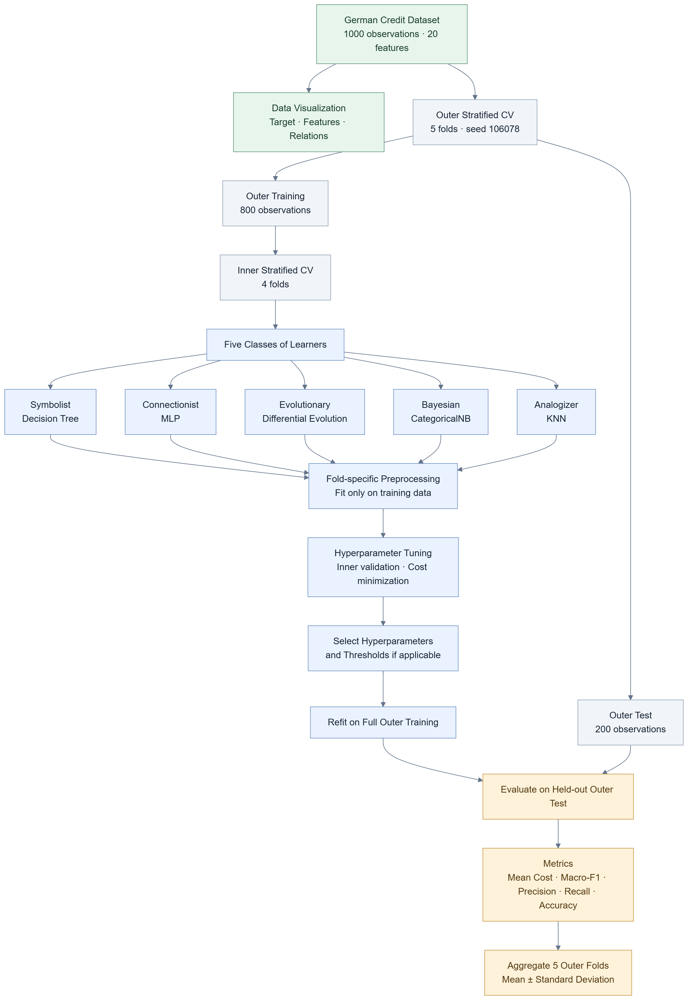

*Figure 11: Experimental workflow showing the German Credit dataset, exploratory analysis, five learner classes, nested cross-validation, preprocessing, hyperparameter selection and final evaluation. The outer test partitions are kept separate from the tuning process.*

Figure 11 summarises the procedure. The important distinction is that the inner folds are used for model selection, while the outer folds are used to estimate performance on observations that were not involved in that selection.

### 4.2. Nested Stratified Cross-Validation

Nested Cross-Validation uses two levels of data splitting, each with a different purpose.

The **outer cross-validation** is responsible for evaluating the models. The **inner cross-validation** is responsible for selecting hyperparameters and, when applicable, decision thresholds.

Both levels use `StratifiedKFold`, with `shuffle=True` and `random_state=106078`.

#### Outer Cross-Validation

The dataset is divided into five outer folds. In each iteration, four folds are used for training and model selection, while the remaining fold is reserved for testing.

This gives 800 outer training observations and 200 outer test observations per iteration.

Because stratification preserves the original 70/30 class distribution, every outer test fold contains 140 good and 60 bad credit risks.

Each observation appears in the outer test partition exactly once for each learner. By the end of the five iterations, every model has produced 1,000 held-out predictions.

#### Inner Cross-Validation

Within each outer training partition, another `StratifiedKFold` divides the 800 observations into four folds.

For each inner iteration, the model is fitted using 600 observations and evaluated using the remaining 200 observations. The process is repeated four times, so each observation in the outer training partition is used for inner validation once.

The sizes and class distributions are summarised in Table 9.

| Partition | Observations | Good | Bad |
|---|---:|---:|---:|
| Complete dataset | 1,000 | 700 | 300 |
| Outer training | 800 | 560 | 240 |
| Outer test | 200 | 140 | 60 |
| Inner training | 600 | 420 | 180 |
| Inner validation | 200 | 140 | 60 |

*Table 9: Number of observations and class distribution in the nested cross-validation partitions. The inner partitions are created from the outer training set.*

Using four inner folds allows each hyperparameter configuration to be evaluated on different validation partitions rather than relying on only one split.

After the best configuration is selected, a new model is fitted using all 800 outer training observations. Its performance is then measured on the 200 observations of the outer test fold.

The outer test results are not used to change hyperparameters or decision thresholds. This separation is necessary because evaluating a model on the same data used to select it would give an overly optimistic estimate of its performance.

### 4.3. Preprocessing and Data Leakage Prevention

Each learner requires a different representation of the input features. For this reason, preprocessing was implemented as part of each model's scikit-learn `Pipeline`.

The transformations used for each learner are shown in Table 10.

| Learner | Categorical features | Numerical features |
|---|---|---|
| Decision Tree | One-hot encoding | Original values |
| MLP | One-hot encoding | StandardScaler |
| Evolutionary | One-hot encoding | StandardScaler |
| CategoricalNB | Ordinal encoding | Quantile discretisation for selected features; remaining discrete values unchanged |
| KNN | One-hot encoding | StandardScaler |

*Table 10: Preprocessing applied to each learner before model training.*

For the Decision Tree, categorical attributes are converted into binary columns using `OneHotEncoder`. Numerical values are passed through without scaling because the tree makes decisions based on feature splits rather than distances.

The MLP, KNN and Evolutionary classifiers use one-hot encoding for categorical attributes and `StandardScaler` for numerical attributes.

StandardScaler transforms a numerical feature using its training mean and standard deviation:

$$
z = \frac{x-\mu}{\sigma}
$$

Here, $\mu$ and $\sigma$ are calculated from the training partition. Standardisation is particularly relevant for KNN, where distances would otherwise be strongly affected by features with larger numerical ranges. It also gives the MLP and Evolutionary classifier inputs with more comparable scales.

CategoricalNB requires non-negative integer feature values rather than one-hot encoded inputs. Categorical attributes are therefore transformed using `OrdinalEncoder`. Unknown categories are initially assigned `-1`, and all encoded values are shifted by one, reserving `0` for unknown categories.

Three numerical attributes, `duration`, `credit_amount` and `age`, are discretised using `KBinsDiscretizer` with quantile-based intervals. The number of bins is selected during hyperparameter tuning. The remaining four numerical attributes already contain a small number of discrete values and are passed through unchanged.

#### Preventing Data Leakage

A central part of the methodology is ensuring that preprocessing does not use information from validation or test observations when fitting its transformations.

During each inner fold, the preprocessing pipeline is fitted only on the 600 inner training observations. The corresponding 200 validation observations are then transformed using the fitted encoder, scaler or discretisation boundaries.

The same rule applies after model selection. When the selected model is refitted on the 800 outer training observations, its preprocessing is also fitted again using only those 800 observations. The outer test observations are transformed using those fitted parameters.

This prevents information such as the mean of a numerical feature, the standard deviation, the categories observed during training or the discretisation boundaries from being calculated using validation or test data.

OneHotEncoder was configured with `handle_unknown="ignore"`, allowing the model to process categories that were not present when the encoder was fitted.

There were no missing values in the supplied dataset, so no imputation procedure was required.

### 4.4. Hyperparameter Selection and Decision Thresholds

The hyperparameter configurations evaluated for each learner were defined before running the experiment and are described in Section 2.

For the Decision Tree, MLP, CategoricalNB and KNN, the selection procedure uses the predicted probability of the positive class, `bad`.

For each hyperparameter configuration, the following procedure is applied:

1. Fit the model on the training portion of each of the four inner folds.
2. Predict the probability of `bad` for the corresponding validation observations.
3. Combine these predictions into a set of out-of-fold probabilities covering all 800 outer training observations.
4. Evaluate different probability thresholds using the classification cost.
5. Keep the configuration and threshold that produce the lowest inner out-of-fold cost.

An out-of-fold prediction is obtained from a model that was not trained on the observation being predicted. This allows all 800 outer training observations to contribute to threshold selection without predicting them using models fitted on those same observations.

#### Cost-Sensitive Threshold Selection

For a probabilistic classifier, the default decision threshold is usually 0.5. However, this is not necessarily appropriate for German Credit because the two types of classification errors have different costs.

The prediction rule used in the experiment is:

$$
\hat{y} =
\begin{cases}
1 & \text{if } P(\text{Bad}\mid x) \geq t \\
0 & \text{otherwise}
\end{cases}
$$

where $t$ is the selected decision threshold.

The implementation evaluates 101 thresholds, from `0.00` to `1.00`, with increments of `0.01`.

For each threshold, the probabilities are converted into class predictions and the mean classification cost is calculated. The threshold with the lowest cost is selected.

Under the assumption that the predicted probabilities are correctly calibrated, the theoretical threshold that minimises the expected cost is:

$$
t^* = \frac{C_{FP}}{C_{FP}+C_{FN}}
= \frac{1}{1+5}
= \frac{1}{6}
\approx 0.167
$$

This value is lower than 0.5 because failing to identify a bad credit risk has a higher cost than incorrectly identifying a good credit risk as bad.

The theoretical value is used only to resolve ties between thresholds with equal validation cost. In such cases, the selected threshold is the one closest to $1/6$. If there is still a tie, the smaller threshold is selected.

When two hyperparameter configurations obtain the same minimum inner cost, the implementation keeps the first configuration in the predefined search list.

The selected threshold is then applied to the probabilities produced by the model refitted on the outer training partition. It is not adjusted using the outer test results.

#### Example from the Recorded Experiment

The first outer fold of CategoricalNB provides an example of this procedure.

The inner cross-validation selected `alpha=2.0` and `n_bins=5`, together with a decision threshold of `0.11`. The selected configuration obtained an inner out-of-fold mean cost of `0.4925`.

After the model was refitted on the complete outer training partition, its mean cost on the outer test fold was `0.6000`.

These values were obtained from `results/fold_results.csv`. The difference between the inner and outer costs illustrates why validation performance should not be reported as final test performance.

### 4.5. Evolutionary Model Selection

The Evolutionary classifier follows the same outer and inner cross-validation structure, but its training and model selection procedures are different.

Unlike the other four learners, this model does not estimate class probabilities. It uses Differential Evolution to optimise the weights and bias of a linear classifier.

For a transformed observation $x$, the model calculates:

$$
s(x)=w^Tx+b
$$

The predicted class is `bad` when the score is greater than or equal to zero, and `good` otherwise.

During training, Differential Evolution generates and modifies candidate weight vectors. Each candidate is evaluated using the mean classification cost on the training partition.

The two configurations described in Section 2 were compared:

- Population of 30 individuals and 30 generations.
- Population of 40 individuals and 22 generations.

For each configuration, the evolutionary classifier is trained separately on each of the four inner training folds. Its classification cost is then calculated on the corresponding validation fold.

The four validation costs are averaged, and the configuration with the lowest mean is selected.

After selection, Differential Evolution is run again on the full outer training partition using the selected configuration. The resulting weights and bias are then used to classify the outer test observations.

No probability threshold search is performed for this learner, because its predictions are already defined by the sign of the linear score.

This distinction is important for the project. Differential Evolution is not being used merely to tune another classifier. It directly learns the parameters that determine the final predictions.

### 4.6. Evaluation Metrics and Baselines

The main evaluation metric was selected according to the asymmetric costs of the German Credit problem.

The positive class is `bad = 1`. A false positive occurs when a good credit risk is predicted as bad, while a false negative occurs when a bad credit risk is predicted as good.

The cost of a false positive is 1, and the cost of a false negative is 5.

The primary metric is therefore:

$$
\text{Mean Cost}=\frac{FP+5FN}{N}
$$

where $FP$ is the number of false positives, $FN$ is the number of false negatives and $N$ is the number of evaluated observations.

A lower mean cost indicates better performance under the cost structure defined for this task.

For example, on a test set of 200 observations, 20 false positives and 5 false negatives would produce:

$$
\text{Mean Cost}=\frac{20+5(5)}{200}=0.225
$$

The mean cost is used for hyperparameter and threshold selection, as well as the main comparison of the learners.

Four additional metrics are reported to provide more information about the types of predictions made by the models.

**Accuracy** measures the proportion of correctly classified observations:

$$
\text{Accuracy}=\frac{TP+TN}{N}
$$

**Precision for Bad** measures how many observations predicted as bad actually belong to that class:

$$
\text{Precision}_{Bad}=\frac{TP}{TP+FP}
$$

**Recall for Bad** measures the proportion of actual bad credit risks correctly identified:

$$
\text{Recall}_{Bad}=\frac{TP}{TP+FN}
$$

**Macro-F1** is the average of the F1 scores calculated separately for the two classes:

$$
\text{Macro-F1}=\frac{F1_{Good}+F1_{Bad}}{2}
$$

Macro-F1 gives equal importance to both classes, even when their numbers of observations are different.

Precision and Recall are also useful because a cost-sensitive classifier may identify more bad credit risks at the expense of incorrectly classifying more good credit risks.

The implementation uses `zero_division=0` when calculating Precision, Recall and F1, so undefined values are recorded as zero.

#### Baseline Models

Two constant prediction strategies were included as baselines:

- **Always Good:** predicts class 0 for every observation.
- **Always Bad:** predicts class 1 for every observation.

These baselines do not require training or hyperparameter tuning.

Because each outer test fold contains 140 good and 60 bad credit risks, their costs are:

$$
\text{Always Good Cost}=\frac{5\times60}{200}=1.500
$$

$$
\text{Always Bad Cost}=\frac{140}{200}=0.700
$$

Always Good achieves an accuracy of 70%, but its Recall for the bad class is zero. It does not identify any bad credit risks.

Always Bad achieves only 30% accuracy, but identifies all bad credit risks and has a substantially lower classification cost.

This demonstrates why accuracy alone is not suitable for selecting the best model in this problem.

The baselines provide reference values for the five learners. In particular, a learner should be compared with the Always Bad cost of `0.700`, rather than judged only by its accuracy.

### 4.7. Aggregating Results and Measuring Variability

After the hyperparameters are selected and the model is refitted, the evaluation metrics are calculated on each outer test fold.

This produces five values for each metric and learner.

The reported result is the arithmetic mean of the five outer-fold values:

$$
\bar{m}=\frac{1}{5}\sum_{i=1}^{5}m_i
$$

where $m_i$ represents the metric obtained in outer fold $i$.

To measure how much the results vary across the folds, the sample standard deviation is also calculated:

$$
s=\sqrt{\frac{\sum_{i=1}^{5}(m_i-\bar{m})^2}{5-1}}
$$

The implementation uses NumPy with `ddof=1`, which corresponds to the sample standard deviation.

Reporting both the mean and standard deviation helps distinguish models that obtain similar average results but behave differently across the test partitions.

For example, two learners may have similar mean classification costs, but one may produce much larger differences between folds. This makes its observed performance less consistent across the tested partitions.

The five outer test folds have equal sizes, so the average of their mean costs is also equal to the cost calculated from their combined predictions. For metrics such as Macro-F1, however, the average of the fold scores does not necessarily equal the score calculated from all pooled predictions.

For consistency, the results tables use the mean of the five fold-level metrics.

The standard deviation describes variation across the five folds. It is not presented as a confidence interval, and the experiment does not include repeated cross-validation with several independent random seeds.

Consequently, small differences between learners should be interpreted carefully. The results describe their performance under the selected evaluation procedure, rather than proving that one learner will always perform better on other datasets.

### 4.8. Hyperparameter Search and Computational Cost

The computational cost of tuning was also recorded.

For each learner, every hyperparameter configuration is evaluated using four inner folds, and the process is repeated for each of the five outer folds. After selecting the best configuration, one additional model is fitted on the complete outer training partition.

The total number of model fits is therefore:

$$
N_{\text{fits}}=5\times(4\times N_{\text{configs}}+1)
$$

Across the five learners, 22 configurations were considered. This resulted in 440 inner model fits and 25 outer refits, for a total of 465 fits.

Table 11 shows the number of configurations, model fits and measured execution times.

| Learner | Configurations | Model fits | Execution time |
|---|---:|---:|---:|
| Decision Tree | 4 | 85 | 4.37 s |
| MLP | 4 | 85 | 132.68 s |
| Evolutionary | 2 | 45 | 52.04 s |
| CategoricalNB | 4 | 85 | 4.85 s |
| KNN | 8 | 165 | 9.39 s |
| **Total** | **22** | **465** | **203.34 s** |

*Table 11: Number of evaluated hyperparameter configurations, total model fits and measured execution time across the five outer folds. Times are rounded individually; the total was calculated before rounding.*

The threshold search does not require additional model fits. It reuses the out-of-fold probabilities already obtained during inner cross-validation.

Although KNN required the largest number of fits, its measured execution time was relatively low. In contrast, the MLP was the most time-consuming learner, taking 132.68 seconds across its five outer folds.

The Evolutionary classifier required fewer fits than the other learners, but each fit involved evaluating multiple candidate solutions over several generations. As a result, the number of fits alone does not fully describe its computational cost.

The complete timed part of the experiment took **204.55 seconds**, including baseline evaluation, model selection, outer-fold evaluation and saving results. Dataset loading and initial setup were performed before the timer started.

These times describe the recorded execution and may vary depending on the hardware, Python environment and library versions.

### 4.9. Reproducibility

The experiment was implemented in Python and uses fixed random seeds to make the results reproducible. The recorded execution environment is shown in Table 12.

| Component | Version |
|---|---|
| Python | 3.13.7 |
| NumPy | 2.3.5 |
| scikit-learn | 1.8.0 |
| Polars | 1.44.2 |
| pyBlindOpt | 0.5.0 |

*Table 12: Python and library versions recorded during the experiment.*

The dependencies are listed in `requirements.txt`. The hyperparameter search spaces and random seed are defined in `src/config.py`, while the training and evaluation procedures are implemented in the `src/` directory.

**Running the experiment**

The following commands can be executed from the project root. On Windows, a Python virtual environment can be created and activated using PowerShell:

```powershell
py -3.13 -m venv .venv
.\.venv\Scripts\Activate.ps1
python -m pip install -r requirements.txt
```

The complete experiment can then be executed using:

```powershell
python main.py
```

This runs the five learners and the two baselines using Nested Stratified Cross-Validation. The models are evaluated using the same outer folds, with the random seed fixed at `106078`.

The recorded execution took approximately 204.55 seconds. Execution time may vary depending on the computer and installed libraries.

**Generated results**

The main experiment saves the first five files below in the `results/` directory. The paired comparison script produces the last file:

| File | Contents |
|---|---|
| `fold_results.csv` | Selected hyperparameters, thresholds, metrics and execution times for each outer fold |
| `model_summary.csv` | Mean and sample standard deviation of the evaluation metrics |
| `predictions.csv` | Actual classes and predictions for each outer test observation |
| `baselines.csv` | Performance of Always Good and Always Bad on each outer fold |
| `experiment_config.json` | Random seed, cross-validation settings, hyperparameter search spaces and library versions |
| `paired_fold_differences.csv` | Paired classification cost differences between the learners and CategoricalNB |

The saved results allow the reported costs, confusion matrices and other evaluation metrics to be checked without training the models again.


**Paired comparison**

The paired analysis can be reproduced using the saved outer-fold results and predictions:

```powershell
python -m tests.paired_analysis
```

The script compares classification costs on the same outer folds and examines the predictions where CategoricalNB and KNN disagree. It also saves the fold-level cost differences in `results/paired_fold_differences.csv`.

This analysis uses the existing experimental results and does not require retraining the models.


**Generating the figures**

The figures used in the report can be regenerated using the scripts provided in the `tests/` directory:

```powershell
python -m tests.plot_results
python -m tests.plot_dataset_figures
python -m tests.plot_model_explanations
python -m tests.section5_plots
```

These scripts generate the exploratory plots, learner visualisations, model comparisons, confusion matrices and additional diagnostic figures.

The CategoricalNB calibration plot can also be regenerated using:

```powershell
python -m tests.check_bayesian
python -m tests.check_calibration
```

The first command generates the CategoricalNB predictions required by the calibration script. This is a separate diagnostic run and does not modify the official results of the five learners.

Most figures are saved in `results/figures/`. The calibration plot is saved as `results/bayesian_calibration.png`.

The experimental pipeline diagram (`results/figures/pipeline.png`) is included directly in the repository.

**Running the tests**

The automated tests can be executed using:

```powershell
python -m pytest tests/ -v
```

These tests are intended to verify the main evaluation functions, data preprocessing and experimental procedures.

The experiment uses fixed seeds, but minor differences in execution time and numerical results may occur across hardware or library environments. The reported results correspond to the recorded execution and the configuration saved in `results/experiment_config.json`.


## 5. Evaluation and Conclusion

This section presents the results obtained from the five learners using the Nested Stratified Cross-Validation procedure described in Section 4.

The comparison focuses on mean classification cost, since the German Credit problem assigns a higher penalty to classifying bad credit risks as good. Accuracy, Macro-F1, Precision and Recall are also considered to understand the different types of errors made by each learner.

The results are then discussed in relation to the characteristics of the dataset and the assumptions made by each learning approach. The objective is not only to identify the learner with the lowest cost, but also to understand why the different algorithms behaved as they did.

### 5.1. Overall Performance Comparison

Table 13 presents the average performance of the five learners and the two constant baselines across the five outer folds.

The classification cost is reported as mean ± sample standard deviation. The remaining metrics are presented as their mean values across the folds.

| Learner | Mean Cost ↓ | Macro-F1 ↑ | Precision (Bad) ↑ | Recall (Bad) ↑ | Accuracy ↑ |
|---|---:|---:|---:|---:|---:|
| **CategoricalNB** | **0.547 ± 0.046** | 0.552 | 0.395 | **0.917** | 0.553 |
| KNN | 0.575 ± 0.146 | **0.575** | **0.405** | 0.873 | **0.577** |
| MLP | 0.602 ± 0.048 | 0.547 | 0.392 | 0.873 | 0.550 |
| Decision Tree | 0.621 ± 0.085 | 0.545 | 0.387 | 0.860 | 0.547 |
| Evolutionary | 0.705 ± 0.100 | 0.459 | 0.347 | 0.857 | 0.467 |
| Always Bad | 0.700 ± 0.000 | 0.231 | 0.300 | 1.000 | 0.300 |
| Always Good | 1.500 ± 0.000 | 0.412 | 0.000 | 0.000 | 0.700 |

*Table 13: Mean performance of the five learners and two baselines across the outer folds. Bold values indicate the best result among the five learners for each metric. Lower classification cost is better.*

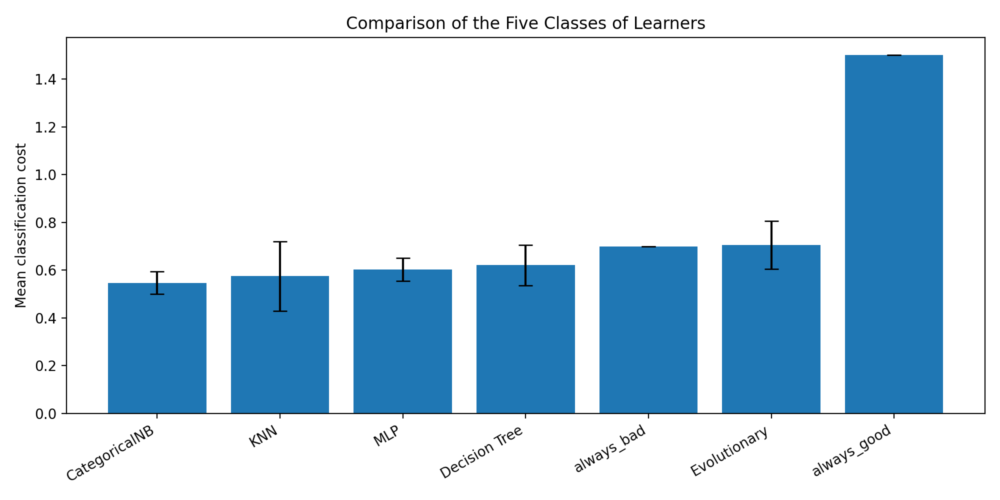

*Figure 12: Mean classification cost of the five learners and the two baselines. Error bars represent one sample standard deviation across the five outer folds.*

CategoricalNB obtained the lowest mean classification cost, at 0.547, followed by KNN at 0.575. Both performed better than the Always Bad baseline, which has a mean cost of 0.700.

Compared with Always Bad, CategoricalNB reduced the mean classification cost by approximately 21.9%. KNN achieved a reduction of approximately 17.9%.

The MLP and Decision Tree also improved on the baseline, but their mean costs were higher, at 0.602 and 0.621, respectively.

The Evolutionary classifier obtained a mean cost of 0.705, slightly above the Always Bad baseline. Under the primary metric, it therefore did not improve on that simple prediction strategy.

The ranking changes when the other metrics are considered. KNN achieved the highest Accuracy (0.577), Macro-F1 (0.575) and Precision for the bad class (0.405) among the five learners. CategoricalNB, however, achieved the highest Recall for bad credit risks (0.917).

This difference is important because the evaluation metric penalises false negatives five times more than false positives. A learner can obtain better Accuracy or Macro-F1 while still producing a higher classification cost.

The Always Good baseline is another example of this difference. It achieves 70% Accuracy simply by predicting the majority class, but it fails to identify any of the 300 bad credit risks.

These results show why the choice of evaluation metric matters. In this problem, identifying bad credit risks has a greater influence on the total cost than maximising the number of correct predictions.

### 5.2. Performance Across Outer Folds

The mean results provide an overall comparison, but they do not show how the learners behaved on the individual test partitions.

Table 14 presents the classification cost obtained by each learner in the five outer folds.

| Outer Fold | Decision Tree | MLP | Evolutionary | CategoricalNB | KNN |
|---|---:|---:|---:|---:|---:|
| 1 | 0.625 | 0.560 | 0.725 | 0.600 | **0.485** |
| 2 | 0.740 | 0.610 | 0.690 | **0.535** | 0.715 |
| 3 | **0.545** | 0.650 | 0.710 | 0.560 | 0.705 |
| 4 | 0.660 | 0.645 | 0.840 | **0.565** | 0.595 |
| 5 | 0.535 | 0.545 | 0.560 | 0.475 | **0.375** |

*Table 14: Classification cost obtained by each learner on the five outer test folds. Bold values indicate the lowest cost within each fold.*

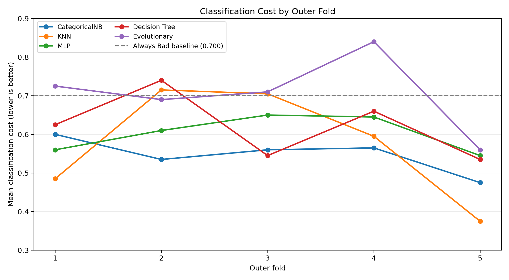

*Figure 13: Classification cost of each learner across the five outer folds. The dashed line represents the Always Bad baseline cost of 0.700.*

Figure 13 shows that the differences between learners were not the same in every fold.

CategoricalNB obtained costs between 0.475 and 0.600, with a standard deviation of 0.046. This was the lowest cost variation among the five learners, slightly below the MLP's standard deviation of 0.048.

KNN showed a different pattern. Its classification cost ranged from 0.375 in fold 5 to 0.715 in fold 2, resulting in the highest standard deviation (0.146).

Although CategoricalNB had the lowest mean cost, KNN performed better than CategoricalNB in folds 1 and 5. The Decision Tree obtained the lowest cost of all learners in fold 3.

This means that no learner was consistently the best across all five test partitions.

The results suggest that KNN can perform particularly well on some partitions of the dataset, but its performance was less consistent in this experiment. Since KNN relies on distances to training observations, differences in the available neighbours may affect its predictions.

CategoricalNB showed less variation, possibly because its probability estimates use the distribution of feature values within each class rather than relying on individual nearby observations.

However, these are possible explanations. The experiment did not directly measure how changes in neighbourhood structure or estimated feature probabilities caused the differences between folds.

The five outer folds also share overlapping training data. Their results should not be treated as five completely independent experiments, and the standard deviations are not confidence intervals.

For this reason, the difference of 0.028 between the mean costs of CategoricalNB and KNN is not enough to establish that CategoricalNB would always perform better on new data.


#### Paired Comparison of the Learners

Since all five learners were evaluated on the same outer test folds, their classification costs can also be compared directly within each fold.

CategoricalNB was used as the reference because it obtained the lowest mean classification cost. For each learner, the difference was calculated by subtracting the CategoricalNB cost from its cost on the same fold.

A positive difference means that CategoricalNB had a lower cost, while a negative difference means that the other learner performed better.

| Learner compared with CategoricalNB | Mean difference | SD of differences | Folds with lower cost than NB |
|---|---:|---:|---:|
| KNN | +0.028 | 0.136 | 2/5 |
| MLP | +0.055 | 0.054 | 1/5 |
| Decision Tree | +0.074 | 0.084 | 1/5 |
| Evolutionary | +0.158 | 0.071 | 0/5 |

*Table 15: Paired differences in classification cost relative to CategoricalNB. The mean and sample standard deviation were calculated from the five fold-level differences.*

The paired comparison confirms that CategoricalNB had the lowest average cost, but the differences were not consistent across all folds.

For example, KNN performed better than CategoricalNB in two of the five folds. Its mean difference was only 0.028, while the standard deviation of the paired differences was 0.136.

This shows that the advantage of CategoricalNB over KNN was not equally strong across the test partitions.

A further comparison was made using the 1,000 saved outer test predictions from both learners. CategoricalNB and KNN disagreed on 190 observations.

KNN correctly classified 107 observations that CategoricalNB classified incorrectly. However, it also incorrectly classified 83 observations that CategoricalNB predicted correctly.

Although KNN made more correct predictions in these disagreements, the types of errors were different. Compared with CategoricalNB, KNN corrected 97 errors involving good credit risks and 10 involving bad credit risks, but introduced 60 errors involving good credit risks and 23 involving bad credit risks.

Considering the classification costs, the corrected errors saved 147 cost units, while the additional errors introduced 175 units. This resulted in a net increase of 28 cost units for KNN, corresponding to the difference of 0.028 in mean cost.

This helps explain why KNN achieved higher Accuracy and Macro-F1, while CategoricalNB obtained a lower classification cost.

However, the five outer folds share overlapping training observations. The standard deviation of the paired differences should therefore not be interpreted as a confidence interval or used alone to establish statistical significance.

The results support CategoricalNB as the lowest-cost learner in this experiment, but do not establish that it is generally superior to the other algorithms.


### 5.3. Classification Errors and Their Costs

To understand the classification costs, it is necessary to examine the types of errors made by each learner.

The confusion matrices in Figure 14 were calculated by combining the 1,000 held-out predictions produced by each learner across the five outer folds.

Each observation was predicted once by a model that had not been trained on that observation.

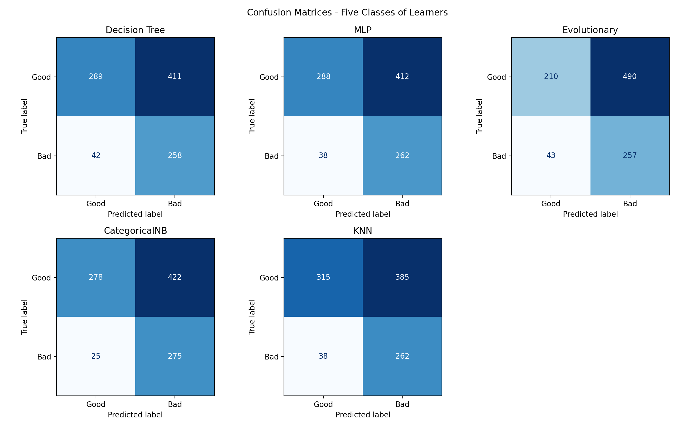

*Figure 14: Confusion matrices obtained from the combined outer test predictions of the five learners. Rows represent actual classes and columns represent predicted classes.*

The corresponding values are presented in Table 16.

| Learner | TN | FP | FN | TP |
|---|---:|---:|---:|---:|
| Decision Tree | 289 | 411 | 42 | 258 |
| MLP | 288 | 412 | 38 | 262 |
| Evolutionary | 210 | 490 | 43 | 257 |
| **CategoricalNB** | 278 | 422 | **25** | **275** |
| KNN | **315** | **385** | 38 | 262 |

*Table 16: Combined confusion matrix counts from the five outer test folds. TN and TP represent correct predictions, while FP and FN represent the two types of classification errors.*

CategoricalNB correctly identified 275 of the 300 bad credit risks, missing only 25. This explains its high Recall of approximately 91.7%.

However, it also classified 422 of the 700 good credit risks as bad. In other words, it incorrectly flagged approximately 60% of the good cases.

This is an important limitation. The model achieved a low classification cost, but it did so partly by predicting the bad class frequently.

KNN produced fewer false positives, with 385 compared with 422 for CategoricalNB. However, it missed 38 bad credit risks, compared with only 25 for CategoricalNB.

The difference becomes clearer when the costs of the two error types are considered separately.

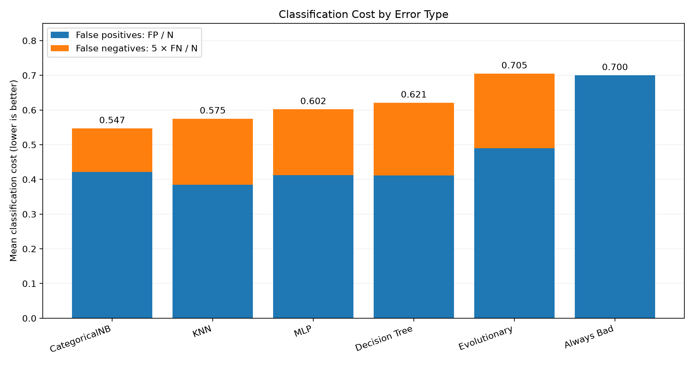

*Figure 15: Mean classification cost divided into the contribution from false positives (FP/N) and false negatives (5FN/N). The Always Bad baseline is included for comparison.*

The classification cost can be separated into two components:

$$
\text{Mean Cost} = \frac{FP}{N} + \frac{5FN}{N}
$$

For CategoricalNB, the two components are:

$$
\frac{422}{1000}=0.422
$$

$$
\frac{5\times25}{1000}=0.125
$$

This gives a total mean cost of 0.547.

For KNN, the corresponding values are 0.385 and 0.190, giving a total cost of 0.575.

Compared with KNN, CategoricalNB made 37 additional false-positive errors, but 13 fewer false-negative errors.

Those 13 avoided false negatives represent 65 units of classification cost, while the 37 additional false positives represent only 37 units.

Therefore, CategoricalNB achieved a net reduction of 28 cost units over the 1,000 observations, explaining the difference of 0.028 in mean classification cost.

This is the main reason why CategoricalNB performed better under the selected cost function, despite having lower Accuracy and Macro-F1 than KNN.

The Evolutionary classifier provides another useful comparison. It produced 490 false positives and 43 false negatives, corresponding to a total cost of:

$$
\frac{490+5(43)}{1000}=0.705
$$

Compared with Always Bad, it avoided 210 false positives by correctly identifying some good cases. However, it introduced 43 false negatives, adding 215 cost units.

The additional cost of those false negatives was slightly higher than the cost saved by reducing false positives. This explains why the Evolutionary classifier did not improve on the Always Bad baseline.

These comparisons show that the total number of errors is not enough to evaluate the models. The type of error, and its assigned cost, has a direct influence on the results.

### 5.4. Decision Thresholds and Probability Calibration

The Decision Tree, MLP, CategoricalNB and KNN produce probabilities that can be converted into class predictions using a decision threshold.

As described in Section 4, the thresholds were selected using inner out-of-fold predictions rather than the outer test data.

Since false negatives have a higher cost, the selected thresholds were generally lower than the conventional value of 0.5.

For CategoricalNB, the selected thresholds across the five outer folds were 0.11, 0.13, 0.08, 0.07 and 0.06.

For KNN, the selected thresholds ranged from 0.16 to 0.19, remaining relatively close to the theoretical cost-sensitive threshold of approximately 0.167.

#### Threshold Sensitivity of CategoricalNB

Figure 16 shows how the classification cost changes when different fixed thresholds are applied retrospectively to the saved outer test probabilities of CategoricalNB.

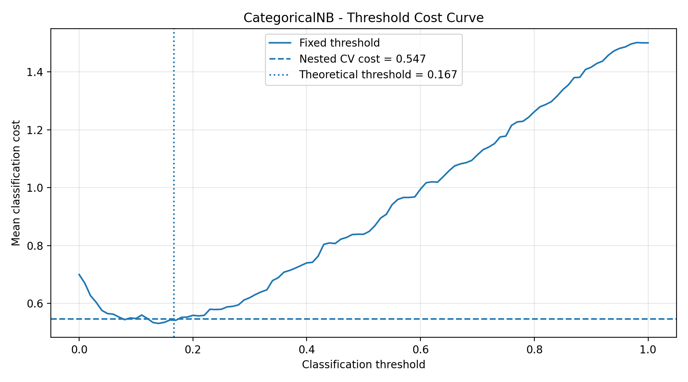

*Figure 16: CategoricalNB classification cost for different fixed thresholds applied to the combined outer test probabilities. The horizontal line shows the actual nested-CV mean cost of 0.547, obtained using the separately selected threshold of each fold. The vertical line indicates the theoretical threshold of 1/6.*

The curve shows that the classification cost depends strongly on the decision threshold.

At low thresholds, more observations are classified as bad. This increases the number of false positives but helps identify more bad credit risks.

As the threshold increases, fewer observations are classified as bad. False positives decrease, but more bad cases may be incorrectly classified as good.

Because false negatives are five times more expensive, increasing the threshold too much can substantially increase the classification cost.

For example, applying a fixed threshold of 0.5 to the saved CategoricalNB probabilities would produce a mean cost of 0.839. This is considerably higher than the reported nested-CV cost of 0.547.

This comparison illustrates the importance of cost-sensitive decision thresholds.

However, the fixed-threshold curve was calculated after obtaining the outer test predictions. It is used only as a diagnostic. Its minimum was not used to choose or modify the thresholds reported in the experiment.

The official result remains the cost obtained with thresholds selected independently inside each outer training partition.

#### Probability Calibration

A probability estimate is well calibrated when observations assigned a certain predicted probability have approximately the corresponding observed frequency of the positive class.

For example, among observations assigned a probability close to 0.3, approximately 30% should belong to the bad class if the estimates are well calibrated.

Figure 17 compares the predicted probabilities of CategoricalNB with the observed proportion of bad credit risks.

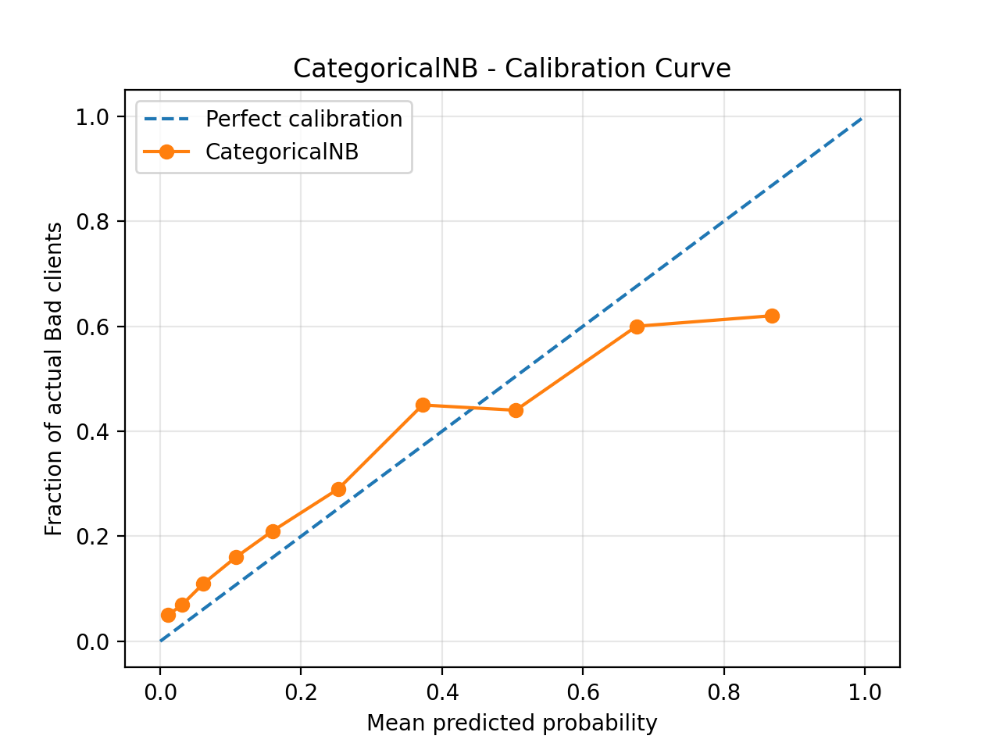

*Figure 17: Calibration curve of CategoricalNB using its combined outer test probabilities, grouped into ten quantile-based bins. The dashed diagonal represents perfect calibration. This plot was generated for analysis and was not used during model selection.*

The curve does not follow the diagonal perfectly.

At lower predicted probabilities, the observed proportion of bad credit risks is often somewhat higher than the estimated probability. At higher predicted probabilities, particularly above approximately 0.6, the observed proportion is lower than the predictions.

This suggests that CategoricalNB's probabilities are not perfectly calibrated, even though they provide useful information for classification.

The Brier score, which measures the mean squared difference between predicted probabilities and actual binary outcomes, was approximately 0.177.

For comparison, always predicting the overall bad-class proportion of 0.30 would give a Brier score of 0.210.

The lower Brier score indicates that the model's probability estimates contain useful predictive information compared with this constant reference.

However, the calibration curve shows that the estimated probabilities should not automatically be interpreted as precise credit risk probabilities.

This is relevant because the theoretical threshold of 1/6 assumes correctly calibrated probabilities. Imperfect calibration and differences between validation partitions may help explain why the thresholds selected for CategoricalNB were lower.

Calibration was not performed as an additional training step in this experiment.

### 5.5. Model Complexity and Hyperparameter Selection

The models were evaluated using the hyperparameter search spaces defined in Section 2.

The selected configurations provide additional information about how the different learners behaved.

For KNN, the same configuration was selected in all five outer folds: 21 neighbours, distance weighting and Manhattan distance (`p=1`).

This suggests that, among the tested configurations, using more neighbours with distance-based weighting was consistently preferred during inner validation.

CategoricalNB selected five discretisation bins in four of the five outer folds. The smoothing parameter `alpha` varied between 0.5 and 2.0.

The MLP selected `alpha=0.1` in all five folds. A hidden layer with eight neurons was selected in four folds, while 16 neurons were selected in one.

These choices suggest that the stronger regularisation setting and a relatively small network were preferred within the tested search space. However, this does not establish that these settings are globally optimal.

For the Decision Tree, the selected maximum depths were 3 and 5. The tested depth of 8 was not selected in any outer fold.

#### Decision Tree Validation Curve

A separate validation curve was generated to examine how increasing tree depth affects training and validation costs.

The curve uses the first outer training partition, with four inner folds, `min_samples_leaf=15` and a fixed decision threshold of 1/6.

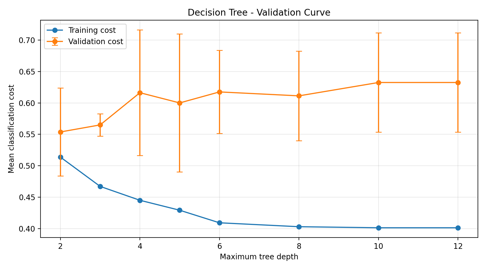

*Figure 18: Mean training and validation classification costs for different Decision Tree depths. The experiment uses only the first outer training partition. Error bars show one sample standard deviation of validation cost across its four inner folds.*

Figure 18 shows that training cost decreases as tree depth increases.

At depth 2, the mean training cost is approximately 0.51. It decreases to approximately 0.40 for depths 10 and 12.

The validation cost does not follow the same pattern. It is approximately 0.55 at depth 2 and increases to around 0.63 at depths 10 and 12.

This behaviour is consistent with overfitting: deeper trees can represent increasingly specific rules that improve performance on the training observations without improving performance on unseen validation data.

The validation error bars overlap, so the figure does not establish a precise optimal depth.

Also, this curve is a separate diagnostic. It is not identical to the official tuning procedure, which evaluates the predefined configurations and selects a classification threshold using inner out-of-fold predictions.

Nevertheless, the result helps explain why additional tree complexity did not necessarily improve classification cost.

### 5.6. Discussion of the Five Learner Classes

The main objective of the project was to compare different approaches to learning from data.

Each learner represents a different way of using the available information. The observed results can therefore be related to the characteristics and assumptions of the five classes.

#### Symbolists — Decision Tree

The Decision Tree represents the Symbolist class by learning a set of conditions that divide observations into smaller groups.

One advantage of this approach is that the learned rules can be inspected. The tree visualisation in Section 2 shows that `checking_status` appears in the first split, suggesting that the model found this attribute useful for separating the training observations.

This is consistent with the exploratory analysis in Section 3, where checking account status showed considerable differences in bad credit rates.

However, the Decision Tree obtained a mean cost of 0.621, higher than CategoricalNB, KNN and MLP.

The validation curve also shows that increasing tree depth improves training cost without consistently improving validation cost.

These results suggest that more detailed decision rules may become too specific to the available training observations.

The tree can represent interactions between attributes, but its flexibility did not lead to the lowest classification cost in this experiment.

#### Connectionists — Multi-Layer Perceptron

The MLP represents the Connectionist class by learning weights between neurons through backpropagation.

Unlike a linear classifier, its hidden layer allows it to represent non-linear relationships between input attributes.

This flexibility could be useful for German Credit, since the exploratory analysis suggests that credit risk cannot be explained by a single numerical feature.

However, the MLP obtained a mean cost of 0.602. Although it performed better than the Decision Tree and Evolutionary classifier, it did not outperform CategoricalNB or KNN.

The selection of `alpha=0.1` in all outer folds suggests that regularisation was useful within the evaluated configurations.

One possible explanation is that the dataset's 1,000 observations may not provide enough information for the additional flexibility of the neural network to produce a clear advantage.

The MLP was also the most computationally expensive learner in the experiment, requiring approximately 132.68 seconds across the five outer folds.

Its higher computational cost therefore did not result in better performance under the primary metric.

These results do not show that neural networks are unsuitable for credit classification. They show that this particular MLP, with the tested architectures and training procedure, did not achieve the best cost on the available dataset.

#### Evolutionaries — Differential Evolution

The Evolutionary class was represented by a linear classifier whose weights and bias were learned directly using Differential Evolution.

Unlike the MLP, the optimisation does not rely on gradients. Instead, it evaluates populations of candidate parameter vectors and searches for combinations that reduce classification cost.

The convergence curve in Section 2 shows that the evolutionary search was able to improve the classification cost on its training partition.

However, the final nested-CV evaluation produced the highest mean cost among the five learners, at 0.705.

The result can be related to two characteristics of the implementation.

First, although the parameters are learned through an evolutionary algorithm, the classifier uses a linear decision boundary. It therefore cannot directly represent more complex non-linear relationships in the transformed feature space.

Second, the fitness function is based on discrete classification errors. Small changes in weights may leave all predicted classes unchanged, producing the same cost for different candidate solutions.

This creates regions where the optimisation algorithm receives little information about whether a small parameter change is useful.

The search budget was also limited to relatively small populations and numbers of generations to keep the experiment computationally manageable.

These factors may have contributed to the weaker result, but the experiment does not determine which of them had the greatest effect.

The important conclusion is that evolutionary learning was implemented and evaluated directly, but it did not provide a performance advantage under the selected model representation and search budget.

#### Bayesians — Categorical Naive Bayes

CategoricalNB represents the Bayesian class by estimating class probabilities from the distributions of discrete feature values.

This approach was considered suitable for German Credit because 13 of the 20 input attributes are categorical.

It also requires relatively few parameters compared with more flexible models, making it practical for a dataset with only 1,000 observations.

The results support this choice. CategoricalNB obtained the lowest mean classification cost and the highest Recall for bad credit risks.

Its performance does not mean that all of its assumptions are correct.

CategoricalNB assumes that the features are conditionally independent given the class. In practice, credit attributes may contain relationships that are not represented by this assumption.

For example, Section 3 identified a correlation between credit duration and credit amount. Although this does not by itself prove conditional dependence within each class, it shows that relationships between attributes deserve consideration.

Despite its simplified representation, CategoricalNB performed well under the selected cost-sensitive evaluation.

A major part of this result came from its ability to identify bad credit risks using relatively low decision thresholds.

The calibration analysis also shows that its estimated probabilities are not perfect. Good classification performance under a cost function therefore does not guarantee accurate estimates of individual credit risk.

#### Analogizers — K-Nearest Neighbors

KNN represents the Analogizer class by classifying new observations according to similar examples from the training set.

Its main assumption is that observations that are close under the chosen distance measure are likely to have similar outcomes.

The preprocessing was particularly important for this learner. Numerical attributes were standardised and categorical attributes were one-hot encoded so that distances could be calculated on a common feature representation.

KNN obtained the highest Accuracy, Macro-F1 and Precision among the five learners. It also achieved the lowest classification cost in two of the five outer folds.

These results suggest that the available feature representation contains useful local patterns for distinguishing credit risks.

However, KNN also showed the greatest variation in classification cost across the outer folds.

One possible reason is that its predictions depend directly on the composition of the training set and the distances to available neighbours. A different training partition may change which observations are considered similar.

Also, the input space contains many dimensions after categorical encoding. In such spaces, the distance metric and feature representation can strongly influence which observations are treated as neighbours.

These characteristics may help explain the observed variation, but the experiment did not isolate their individual effects.

Overall, KNN provided competitive results, particularly on the secondary metrics, but was less consistent than CategoricalNB under the primary classification cost.

### 5.7. Expected Behaviour and Main Findings

The learner choices in Section 2 were based on their different approaches to learning and their expected suitability for German Credit.

The results allow these expectations to be discussed.

**CategoricalNB** was expected to be a reasonable choice because the dataset contains many categorical features and relatively few observations. Its low mean cost and high bad-class Recall support this expectation, although the probability calibration results reveal an important limitation.

**KNN** was selected to examine whether applicants with similar recorded characteristics also tend to have similar credit outcomes. Its results suggest that similarity-based classification can work well on this dataset, but its performance varied substantially between folds.

**Decision Tree and MLP** were selected partly because they can represent non-linear relationships and interactions between attributes. Both improved on the Always Bad baseline, but their additional flexibility did not produce the lowest mean cost. The Decision Tree validation curve also suggests that increasing complexity can lead to overfitting.

**Differential Evolution** was selected to test evolutionary learning as an alternative optimisation approach. The algorithm successfully learned the parameters of a classifier through evolutionary search, but the resulting mean cost was slightly worse than the Always Bad baseline. The expectation that direct cost optimisation could outperform the constant baselines was therefore not supported by the outer test results.

Together, these results suggest that a more flexible model or a more computationally expensive training procedure does not necessarily provide better performance.

They also show that the classification objective matters. CategoricalNB was the best learner according to mean cost, while KNN performed better according to Accuracy and Macro-F1.

The most suitable learner therefore depends on the problem being evaluated and on how different errors are valued.

### 5.8. Limitations and Future Work

Some limitations should be considered when interpreting the results.

The first is the size of the dataset. With only 1,000 observations, the number of bad credit risks in each outer test fold is limited to 60. A relatively small change in the number of false negatives can therefore affect the classification cost considerably.

Although Nested Cross-Validation provides a more reliable evaluation than a single train-test split, this experiment used only one five-fold outer partitioning. The standard deviations describe variation across these folds, but do not measure all possible variation across different random splits or datasets.

The hyperparameter search spaces were also intentionally limited. This kept the complete experiment within a few minutes, but means that better configurations may exist outside the tested values.

For the MLP, the fixed limit of 800 iterations and the absence of early stopping do not guarantee that every training run reached complete convergence.

For the Evolutionary classifier, the search budget and the linear model representation may have restricted performance. Although additional exploratory settings were examined separately, the reported results are limited to the configurations evaluated through the official nested-CV procedure.

Another limitation is the dependence on the selected classification costs. The ratio of 5:1 was defined by the problem, but different costs could change which learner is preferable and how decision thresholds should be selected.

The high number of false positives made by CategoricalNB is particularly important. Its lower mean cost does not automatically make it appropriate for real credit decisions, where incorrectly rejecting suitable applicants may have additional consequences.

The dataset also represents a fixed historical credit classification problem. The results cannot establish whether the same models would perform equally well on recent applicants or different populations.

Possible improvements for future work include:

- **Repeated cross-validation:** use additional random seeds to examine the variability of the results more thoroughly.
- **Probability calibration:** evaluate calibration methods within the inner cross-validation procedure and examine how they affect the selected thresholds and final costs.
- **Larger hyperparameter searches:** test additional tree depths, MLP architectures, regularisation settings and KNN configurations while keeping model selection separate from the outer test data.
- **Evolutionary optimisation:** examine larger search budgets, alternative parameter representations or smoother fitness functions to understand the limitations of the current implementation.
- **External validation:** evaluate the learners on another credit dataset to determine whether the observed results extend beyond German Credit.
- **Practical evaluation:** investigate the effects of false-positive decisions, probability reliability and possible differences in performance between applicant groups before considering real-world use.

### 5.9. Conclusion

This project compared five machine learning algorithms representing the Symbolist, Connectionist, Evolutionary, Bayesian and Analogizer classes on the German Credit dataset.

All learners were evaluated using the same nested cross-validation procedure, with learner-specific preprocessing and hyperparameter selection performed without using the outer test data.

Under the defined classification cost, CategoricalNB obtained the best average result, with a mean cost of 0.547 and a standard deviation of 0.046.

Its main advantage was the high identification rate of bad credit risks. Although it produced more false positives than KNN, it avoided enough costly false negatives to obtain a lower total cost.

KNN was competitive and achieved the best Accuracy and Macro-F1 among the learners, but its results varied more between outer folds.

The Decision Tree and MLP improved on the constant baselines under the primary metric, but their ability to model non-linear relationships did not lead to the lowest cost.

Differential Evolution demonstrated a different way of learning model parameters, but the linear classifier trained through evolutionary search did not outperform the Always Bad baseline.

These results are consistent with the idea that different learning approaches have different strengths and limitations. Their performance depends not only on model complexity, but also on the dataset, feature representation, training procedure and evaluation objective.

For this experiment, the relatively simple CategoricalNB provided the best balance under the specified classification costs. However, its high false-positive rate, imperfect probability calibration and the small dataset remain important limitations.

The main conclusion is that **the most complex or computationally expensive learner is not necessarily the most appropriate one**. Understanding how each learner uses the data, and which errors it makes, is more informative than comparing their final scores alone.

